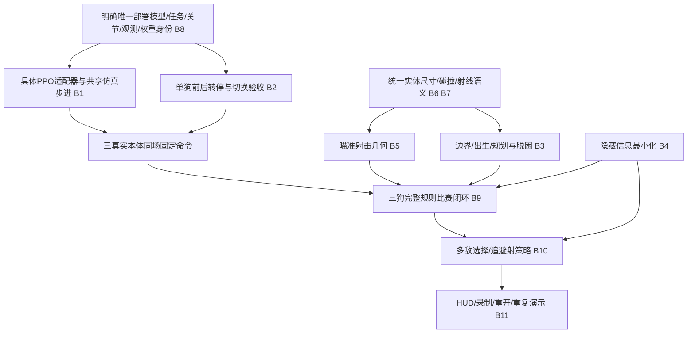

# 阻塞项、依赖关系与三人开发路线

审计日期：2026-11-03（Asia/Shanghai）。本次只读分析与低资源CPU规则测试；未启动Isaac Sim、GPU仿真、训练、模型转换或安装依赖。所有新文件均在本审计目录。

## 当前项目的判断

最成熟的部分是：机械原件/转换与物理诊断资料；Proxy规则核心与轻量测试；单狗训练/评估/日志基础设施；同学原任务短程运动成果。地图已有可显示且可射线遮挡的基础场景，尚不是导航完整的竞技地图。裁判核心比导航成熟，主要缺口是信息最小化、边界语义与多本体集成回归。

历史独有且未接当前主链：旧Dog A训练/策略、20261023旧真A+2Proxy单步；同学Teleop前后转向虽已作11月课程成果，仍没有正式battle适配。V0与v0.2 HUD则仍被当前入口使用，不应误判成全部废弃。

当前不能直接启动一场三最新机器狗自主比赛。第一步scene只生成方块，下一步具体LocomotionAdapter还未实现；即使补接，现有策略停止/运动鲁棒性与地图卡墙都会阻碍稳定对抗。对“完整目标”最大瓶颈是 **系统集成与运动控制共同阻塞**；对“规则演示”最紧迫的是导航/瞄准和信息接口。无需先重写一套裁判。

## 关键问题（有证据与待验证严格区分）

|ID/优先级|阻塞/风险|证据|影响/依赖|
|---|---|---|---|
|B1/P0|正式battle只有Proxy，具体适配器未实现|[dogfight_rl/src/dogfight_v0/runtime.py:38](/home/zxq/robot_projects/dogfight_rl/src/dogfight_v0/runtime.py:38)；[dogfight_rl/src/dogfight_v0/agents/real_locomotion_adapter.py:33](/home/zxq/robot_projects/dogfight_rl/src/dogfight_v0/agents/real_locomotion_adapter.py:33)|真实三狗目标直接断链；依赖先选运动身份|
|B2/P0|运动停车不合格，本地前后转向/四腿验收失败|同学zero vx .032、V7 stop .2126；V6.2后退/转向接近0|停车射击/动作切换无法可靠；先统一验收再优化|
|B3/P0|直线导航不绕障/不脱困|本次24秒卡墙 `AUDIT_PROBES.json`|规则代理也会卡，需可通行图/局部规划及进展监测|
|B4/P0|不可见目标真值通过距离/方位泄漏|VisibilityService返回全部结果；本次可反推(2,0)|破坏5秒情报约束；先收紧观测再扩策略|
|B5/P0|默认fire角阈值允许射不中后停射僵持|本次默认解析120秒、236发3命中平局|先统一命中几何/瞄准门槛；GUI demo参数不能掩盖默认问题|
|B6/P1|狗间重叠/墙体余量/边界不是动力学约束|kinematic set_world_pose、中心margin.25、无外围墙|先体积/碰撞协议，再真实同场压力测试|
|B7/P1|解析与PhysX几何/死者遮挡不同|圆vs方块、解析略死者、物理无禁用Collider|当前静态确认差异；效果待回归|
|B8/P1|训练/策略/模型身份分叉且默认入口过旧|45/48/50维与动作/PD/sole不同，launch仍旧任务|先冻结一套部署清单，禁止直接换权重|
|B9/P1|现有验收多为专项/历史，缺当前比赛全流程证据|smoke与hud历史PASS，真实三狗无记录|需逐层gate，保留命令/版本/结果与视频|
|B10/P2|避险、战术后退、掩体选点未接策略|ScriptedBattlePolicy无对应分支|等运动/导航/信息约束可靠后实现|
|B11/P3|HUD缺倒计时/击杀列表、专用重开/视角、完整回放|BattleHUD仅HP/状态/时间/结果|比赛核心稳定后补展示与操作|

附加局部问题：SpawnManager对于多于3出生点的strict zip会报错；当前3点不触发。外层headless duration默认30而裁判上限120，正常进程退出不保证ROUND_END。顺序射击存在先手语义，暂停/恢复未实现。没有本次物理运行证据时，不把静态风险写成已复现PhysX崩溃。

## 依赖图与必须先做的工作

地图/裁判CPU规则工作可与运动优化并行；“先所有运动训练完成才处理地图”没有必要。三真实本体接入必须先确定身份、具体适配器和共享步进，不能让每只狗的adapter各自推进全局sim一次。自主策略扩展必须先堵情报泄漏，否则验收无效。

## P0：最低可演示版本

目标：三机器人同图按简单规则移动，射击→扣血→死亡→胜负闭环；必须明确展示运动是否为规则驱动、是否真实关节。Proxy基线可作为中间验收，不冒充P0三真实机器狗完成。

已完成：基础TestMap、三Proxy、裁判/HP/日志、HUD文本、历史代理demo；同学单狗运动与视频可复用。

剩余与实施顺序：

1. 选定同学原任务作为候选或另选本地分支，记录URDF/训练URDF/USD/权重SHA、观测/动作/PD/朝向，列明未合格的stop与侧漂；不直接将同学checkpoint塞入V6/V7环境。
2. 修规则观测泄漏与默认瞄准死区，统一demo和默认比赛的规则配置说明。
3. 使用现有地图先完成可演示路径/出生方案；即使使用预设路线，也标明没有自主寻路。
4. 做具体运动适配器，1真狗→3真狗共享仿真，验证命令到关节；用低速规则运动串裁判。
5. 再进行经批准的独立有界GUI整局演示，保存完整事件、结果、视频与失败记录。

依赖：身份→适配→三狗；裁判/地图修订可并行。验收：画面确为三只12关节机器人、各自控制可区分，至少一局有射击命中/扣血/死亡/合法结果，reset后HP/冷却/策略恢复；说明预设路线与自主功能边界，不能用人工扣血凑胜者。若只有三方块或单狗视频，P0仍只是部分完成。

三人任务：建模同学负责碰撞/出生高度/外观与模型身份；强化学习同学负责选策略、动作映射、限速与stop门禁；系统同学负责裁判信息/瞄准、适配接口调度、事件/HUD整局。适配联调由运动与系统共同验收，避免一个人包揽。

## P1：可稳定运行比赛

已完成可沿用：基础规则服务、轻量测试、单狗物理评估工具、P0接口成果（完成后）。

剩余顺序：先稳定stop/左右转/前后命令切换，再统一体积与三狗碰撞、实体边界、出生校验、尸体射线/同帧结算规则；加入卡住检测与安全重置/暂停恢复；多种子多局与长于单个episode的比赛回归。这里“长于episode”不是授权长时间训练，本次未执行。

依赖P0真实关节闭环；可先在CPU层测规则边界。验收：预先约定的多种子整局全部结束，无穿墙/重叠起点/负HP/死者开枪/重复扣血，停止与追踪误差满足组内事先公布的阈值；成功率与样本数如实公布，超时平局可合法结束但不能每局都僵持。阈值应在实验前确定，不事后放宽。

分工：建模负责形体碰撞和出生/地图尺寸验证；运动负责多命令稳定与失败恢复研究；系统负责导航脱困、裁判边界、批量比赛回归与生命周期。共同审核原始轨迹，不用reward代替运动验收。

## P2：自主对战

已有：最近目标选择、5秒intel追踪、可见目标瞄准射击、到达后扫描的规则原型。

剩余顺序：修复且测试信息权限→建立地图可通行图/路径规划/动态避让→丢失目标搜索/卡住重规划→多敌选择、后退/躲避、射击时机/掩体→与已稳定低层策略联调。若需要高层战斗RL/自博弈，先构建可信比赛环境/观测/奖励/终止，再单独申请训练预算；最终自主效果可由规则导航实现，不能把“自主”自动等同“已经训练了战斗RL”。

依赖P1运动、规则与碰撞；验收：隐藏敌人只能按规定情报更新，可见敌人才返回即时观测；机器人能从墙两侧追击、换目标、失去目标后搜索，遇障碍绕行/脱困，决策确实转化PPO关节动作；完整比赛不依赖人工目标/射击/扣血。用成对基线比较胜负、卡住、无效射击与任务结束率。

分工：建模同学负责地图可通行/掩体与枪口/视线高度数据及物理回归；运动同学负责PPO速度接口与复杂命令鲁棒性/策略身份；系统同学负责规划与战术策略。场景评估/实验数据整理由建模与系统共同承担，运动同学参与高层命令可执行性审核。

## P3：最终展示

已有：HP/存活/时间/结果HUD、三色身份、事件记录、单狗视频素材；P2完成后沿用比赛核心。

剩余顺序：统一入口和版本/依赖清单→HUD暴露倒计时/击杀/位置提示→视角切换/重开/暂停恢复→完整录制与可复查事件→老师演示脚本与失败兜底、重复启动/重置验证。

依赖P1闭环、P2自主验收；展示UI可提前开发但不能以精美画面替代功能。验收：按一份运行手册从冷启动复现，清晰看到三狗、HP/时间/情报周期/结果；可连续重开多局，完整视频与日志可对应，不用历史素材冒充本次实况。每次演示注明策略/任务/权重SHA及局限。

分工：建模同学负责场景/身份标识与镜头构图、演示素材；运动同学负责部署清单和运动回归；系统同学负责HUD/操作/录制。三人各维护一套验收证据，共同彩排与交叉操作，不规定没有依据的准确工期。

## 未执行的资源消耗测试清单

先以只读核对+CPU测试冻结身份；后续需另行授权的操作包括1真狗固定命令Isaac加载/站立/前后转停、3本体碰撞、当前GUI HUD、完整单局及多局。每项须预设env数量、模拟秒数、GPU/CPU模式、输出独立目录、失败停止条件，确认没有现有任务冲突。不启动AutoPPO服务或恢复旧训练器；本次没有执行上述项目。
