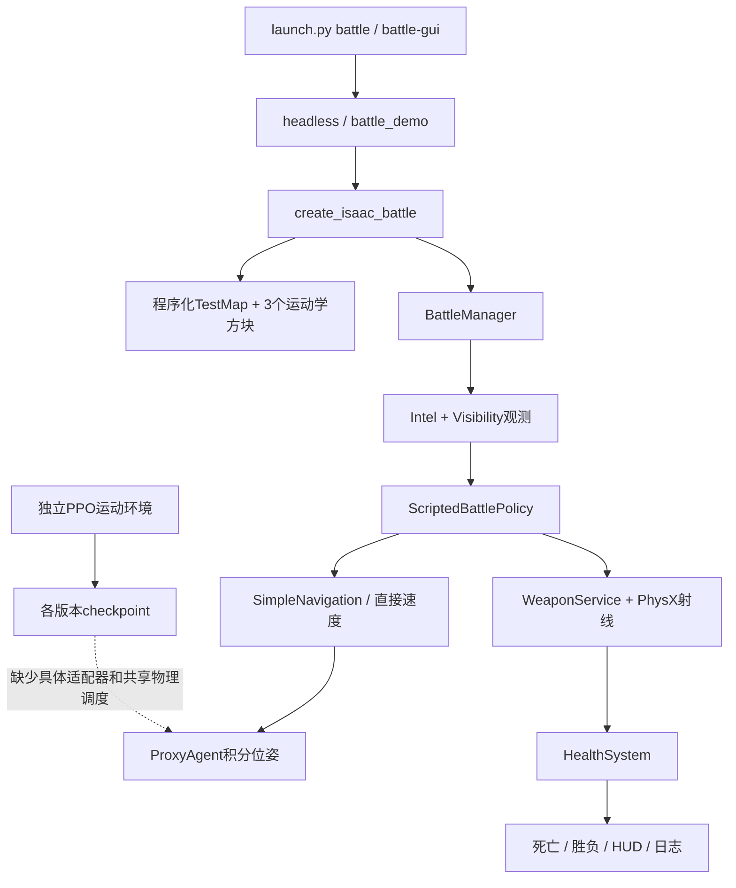

# 项目结构与当前入口

审计日期：2026-11-03（Asia/Shanghai）。本次只读分析与低资源CPU规则测试；未启动Isaac Sim、GPU仿真、训练、模型转换或安装依赖。所有新文件均在本审计目录。

## 核心结论与版本边界

正式业务工程是 `dogfight_rl`，对战入口 `launch.py battle` / `battle-gui`；包名带v0不意味着停用。当前源码保留V0规则与v0.2 HUD。[dogfight_rl/launch.py:44](/home/zxq/robot_projects/dogfight_rl/launch.py:44) 直接分派headless与demo脚本；[dogfight_rl/src/dogfight_v0/runtime.py:38](/home/zxq/robot_projects/dogfight_rl/src/dogfight_v0/runtime.py:38) 明确只实例化3个ProxyAgent，[dogfight_rl/src/dogfight_v0/sim/scene.py:60](/home/zxq/robot_projects/dogfight_rl/src/dogfight_v0/sim/scene.py:60) 创建运动学方块。当前对战不加载URDF、USD关节机器人或checkpoint。

运动分支没有统一升级后的默认入口：`launch.py train/evaluate/play` 仍指向最早csdog_12dof脚本（45/48维观测），V2–V6.3有独立脚本，V7由 `scripts/autoppo/v7.py` 与 `phase_v7_manager.py` 管理。最新试验记录是V7，不能称“已部署主策略”。同学Teleop方案在 `peer_csdog_review/extracted/` 独立运行，11月1日课程汇报采用它的运动成果，但正式battle工厂没有引用它。见[course_presentation/PROJECT_EVIDENCE.md:5](/home/zxq/robot_projects/course_presentation/PROJECT_EVIDENCE.md:5)、[peer_csdog_review/PEER_CSDOG_RUNTIME_TEST.md:1](/home/zxq/robot_projects/peer_csdog_review/PEER_CSDOG_RUNTIME_TEST.md:1)。

## 目录结构

```text
robot_projects/
├── model/                 最新机械原件：URDF、preview、package.xml、13 STL
├── dogfight_rl/            正式工程
│   ├── launch.py          默认命令分派
│   ├── src/dogfight/      模型身份、路径、PPO工具、locomotion多版本、autoppo
│   ├── src/dogfight_v0/   agents/arena/battle/navigation/sim/ui/logging/config
│   ├── assets/            import_v1 USD闭包、sole候选及被拒绝候选
│   ├── configs/           机器人元数据、课程/实验/PPO/服务配置
│   ├── scripts/           train/evaluate/battle/diagnostics/autoppo
│   ├── tests/             规则、接口、预算、评估器等轻量测试
│   ├── runs/locomotion/   V1–V7、A/B诊断、权重、遥测与视频
│   ├── runs/battle/       当前保留的20261026规则smoke
│   └── docs/              当前/过时说明并存
├── peer_csdog_review/      同学发布包、解压源码/策略、当地复测JSON与视频
├── course_presentation/    11月汇报、证据索引；不是运行入口
├── archive/
│   ├── legacy_dog_a/       旧机械本体、训练、策略、诊断
│   ├── legacy_compatibility/ 停用源码/日志实体副本
│   ├── historical_validation/ 历史V0、HUD、混合真A+2代理验收
│   ├── environment_records/ 环境冻结文档与快照
│   └── migration_backups/  历史迁移和压缩备份
├── reorganization/20261026/ 路径映射、保护清单、原文备份
├── IsaacLab/               冻结第三方；仅识别，不逐文件扫描
├── blackhorse_lightstick/  无关灯棒工程，仅目录识别
└── audits/                 本次报告
```

递归目录展开见 `DIRECTORY_TREE.txt`，文件元数据见 `FILE_INVENTORY.json`（11012项，排除第三方IsaacLab、.git、缓存、LibreOffice profile和审计输出；不解压历史大备份）。枚举不代表逐个审读全部文件。地图与战斗命名索引见 `MAP_BATTLE_RESOURCE_INDEX.txt`；checkpoint索引1695项包含历史/重复副本，不表示1695个有效策略。没有修改或执行归档迁移工具。

## 调用关系



真实本体工具[dogfight_rl/src/dogfight_v0/agents/real_dog_agent.py:12](/home/zxq/robot_projects/dogfight_rl/src/dogfight_v0/agents/real_dog_agent.py:12)存在；[dogfight_rl/src/dogfight_v0/agents/real_locomotion_adapter.py:33](/home/zxq/robot_projects/dogfight_rl/src/dogfight_v0/agents/real_locomotion_adapter.py:33)仍抛出未实现异常。接口/mock验证不能代表“决策→PPO→关节→三狗同场”已打通。

## 已有证据分层

|证据|时间|适用范围|限制|
|---|---|---|---|
|当前目录smoke_summary 15 PASS|2026-10-26|三Proxy、PhysX规则专项|不是完整自主策略/三关节机器人比赛|
|归档hud_smoke_summary 6 PASS|2026-10-23|旧HUD GUI专项|本次只复验文本逻辑，需当前GUI回归|
|归档demo_summary|2026-09-20|代理比赛及多局结果|部分早期记录未完成，不能只取成功一条|
|新模型physics_gate|2026-10-26|自由机身、接触、12关节响应|不是行走验收|
|V6.2/V6.3/V7物理评估|2026-10-28～29文件记录|运动退化/不合格证据|不是本次重跑|
|同学原策略当地复测|2026-10-30文件mtime|短程前后/双转/静止、视频|单环境、未接battle；seed20261031不是执行日期|
|本次pytest|2026-11-03|13项规则、HUD文本|解析射线，无GUI/PhysX|
|本次AUDIT_PROBES.json|2026-11-03|静态模型、信息泄漏、卡墙、规则单局|纯CPU内存模型，不是Isaac比赛|

运行时进程只读检查未发现csdog/PPO/battle进程；V7状态JSON仍写DIAGNOSTIC_RUNNING、manager_alive=true，heartbeat停在10月29日，不能当作当前正在训练。未触碰任何现有任务。
